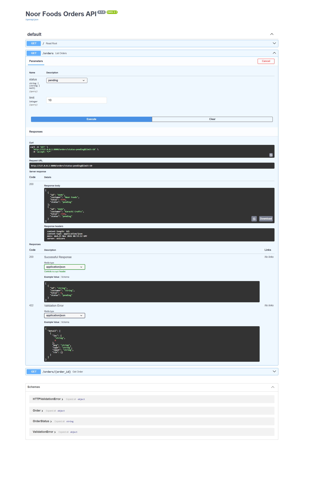
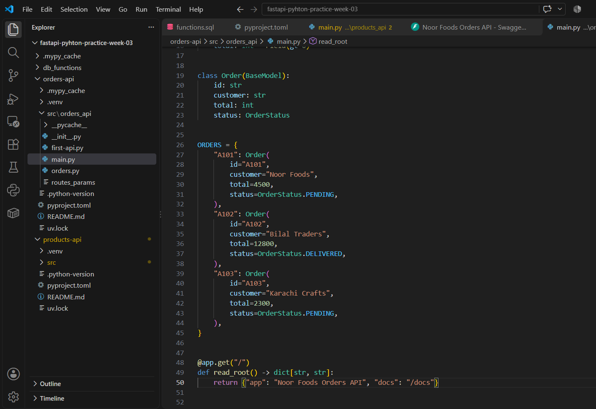

# Noor Foods Orders API – Week 03

A hands-on FastAPI practice project developed as part of my Forward Deployed Engineer (FDE) learning journey.

The project focuses on building REST APIs using Python and FastAPI, working with Pydantic models, handling order data, and understanding API request and response structures.

## Overview

Noor Foods Orders API is a backend practice project that simulates a simple order management system.

It uses Python dictionaries to store sample order records and Pydantic models to define and validate order data.

## Features

- Building API endpoints using FastAPI.
- Defining data models using Pydantic.
- Using Python Enums for order statuses.
- Managing order records using Python dictionaries.
- Handling API requests and responses.
- Working with Python type hints.
- Exploring API documentation through Swagger UI.

## Technologies Used

- **Python** – Backend programming.
- **FastAPI** – REST API development.
- **Pydantic** – Data validation and modelling.
- **Uvicorn** – ASGI server.
- **UV** – Python package and project management.
- **Git & GitHub** – Version control.

## Sample Order Data

The project includes sample order records:

| Order ID | Customer | Total (PKR) | Status |
|---|---|---:|---|
| A101 | Noor Foods | 4,500 | Pending |
| A102 | Bilal Traders | 12,800 | Delivered |
| A103 | Karachi Crafts | 2,300 | Pending |

### Screenshot



### Code Screenshot


## Running the Project

Clone the repository:

```bash
git clone <>
```

Navigate to the project directory:

```bash
cd orders-api
```

Install dependencies:

```bash
uv sync
```

Start the development server:

```bash
uv run uvicorn orders_api.orders:app --reload --app-dir src
```

Open the API documentation:

```text
http://127.0.0.1:8000/docs
```

## What I Learned

During this practice, I explored:

- Creating REST APIs with FastAPI.
- Understanding the structure of a FastAPI application.
- Creating Pydantic models using `BaseModel`.
- Using Enums to define fixed sets of values.
- Working with dictionaries to manage application data.
- Understanding Python type annotations.
- Defining API routes and HTTP methods.
- Exploring automatically generated API documentation using Swagger UI.

## Author

**Nida Ismail**

- GitHub: [@nidaismail](https://github.com/nidaismail)
